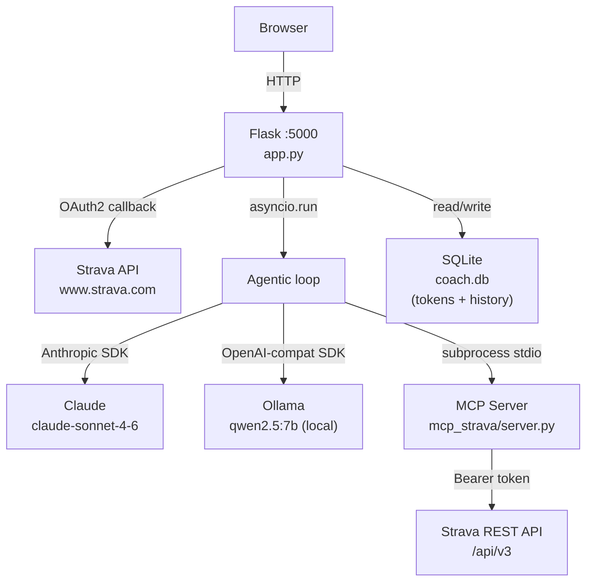

# AI Running Coach

A local web app that connects to your Strava account and lets you chat with an LLM-powered running coach. The coach fetches your real training data via a custom MCP server and answers in natural language.

> **Note:** This app runs entirely on your machine. Your Strava data never leaves your device — only anonymised conversation turns are sent to the LLM API (or stay local with Ollama).


---

## What it does

- Authenticates with Strava via OAuth2 and stores the token locally (SQLite)
- Exposes 5 Strava tools through an MCP server running as a subprocess
- Routes chat messages through an agentic loop: the LLM decides which tools to call, executes them, and synthesises a reply
- Supports two LLM backends: **Anthropic Claude** (API) or **Ollama** (fully local, no cost)
- Persists the conversation history in SQLite

---

## Architecture



---

## MCP tools

The MCP server (`mcp_strava/server.py`) exposes five tools over stdio transport using the Python `mcp` SDK:

| Tool | Description |
|---|---|
| `get_athlete_profile` | Name, city, country, follower/friend counts |
| `get_recent_activities` | Paginated list of recent activities with distance, duration and date |
| `get_activity_detail` | Full detail for one activity: pace, heart rate, elevation, calories |
| `get_athlete_stats` | All-time and year-to-date totals for running, cycling and swimming |
| `get_activity_zones` | Heart-rate and power zone distribution for one activity |

### How the agent uses them

When the user sends a message, `app.py` spawns the MCP server as a subprocess and opens a `ClientSession`. It converts the MCP tool list to the LLM's native function-calling format and enters an agentic loop:

1. Send conversation history + tools to the LLM
2. If `stop_reason == tool_use` (Claude) or `tool_calls` (Ollama): execute each tool call via the MCP session and append the results
3. Repeat until the LLM returns a plain text response (`end_turn`)
4. Persist both the user message and the final reply to SQLite

---

## OAuth2 flow

```
User → GET /auth/strava
     → 302 → strava.com/oauth/authorize?scope=read,activity:read_all,profile:read_all
     ← user grants access
     → GET /callback?code=...
     → POST strava.com/oauth/token  (exchange code → access + refresh token)
     → store tokens in SQLite
     → 302 → /
```

Tokens are refreshed automatically before each Strava API call if they are within 60 seconds of expiry.

---

## Stack

| Layer | Technology |
|---|---|
| Web framework | Flask 3.1 |
| LLM (cloud) | Anthropic Python SDK — `claude-sonnet-4-6` |
| LLM (local) | OpenAI-compat SDK → Ollama |
| MCP server | `mcp` Python SDK, stdio transport |
| Strava API | OAuth2 + REST, `requests` |
| Persistence | SQLite (via `sqlite3` stdlib) |
| Frontend | Vanilla HTML/CSS/JS, Server-Sent Events |
| Tests | pytest + pytest-mock |
| CI | GitHub Actions |

---

## Installation

### Prerequisites

- Python 3.11+
- A [Strava API application](https://www.strava.com/settings/api) (set Callback Domain to `localhost`)
- An [Anthropic API key](https://console.anthropic.com/settings/keys) **or** [Ollama](https://ollama.com) installed locally

### Setup

```bash
git clone https://github.com/<your-username>/ai-running-coach.git
cd ai-running-coach

python -m venv venv
source venv/bin/activate       # Windows: venv\Scripts\activate

pip install -r requirements.txt

cp .env.example .env
# Edit .env — see Configuration section below
```

### Run

```bash
python app.py
```

Open [http://localhost:5000](http://localhost:5000), click **Connect with Strava**, and start chatting.

---

## Configuration

Copy `.env.example` to `.env` and fill in:

| Variable | Required | Description |
|---|---|---|
| `ANTHROPIC_API_KEY` | If `LLM_BACKEND=claude` | Your Anthropic API key |
| `STRAVA_CLIENT_ID` | Yes | Strava app client ID |
| `STRAVA_CLIENT_SECRET` | Yes | Strava app client secret |
| `FLASK_SECRET_KEY` | Yes | Random secret for Flask sessions — generate with `python -c "import secrets; print(secrets.token_hex(32))"` |
| `LLM_BACKEND` | No | `claude` (default) or `ollama` |
| `OLLAMA_MODEL` | If `LLM_BACKEND=ollama` | Model name, default `qwen2.5:7b` |
| `OLLAMA_BASE_URL` | If `LLM_BACKEND=ollama` | Default `http://localhost:11434/v1` |

### Using Ollama (free, no API key)

```bash
# Install Ollama from https://ollama.com, then:
ollama pull qwen2.5:7b

# In .env:
LLM_BACKEND=ollama
OLLAMA_MODEL=qwen2.5:7b
```

---

## Tests

```bash
pip install -r requirements-dev.txt
pytest tests/ -v
```

The test suite covers:
- All 5 MCP tools (mocked Strava responses)
- OAuth token storage, refresh and expiry logic
- Flask routes: auth redirects, unauthenticated chat, empty message validation

---

## Screenshot

Take a screenshot of the chat interface with fictional or blurred activity data and save it to `docs/screenshot.png`.  
Suggested prompt to show: *"Analyse my last 5 runs"* — blur or replace any real dates, distances or names before publishing.

---

## Known limitations and improvement ideas

- **No streaming output**: the LLM reply arrives in one block after the full agentic loop completes. Streaming mid-loop would require a more complex SSE architecture.
- **Single user**: the app is designed for one athlete. Multi-user support would need per-user DB rows and session isolation.
- **Subprocess per request**: a new MCP server process is spawned for each chat message. A persistent server (e.g. via a background thread or async task) would be more efficient.
- **No rate-limit handling**: Strava API errors (429, 5xx) are surfaced as raw error messages.
- **SQLite only**: fine for local use; a production deployment would need a proper database and a WSGI server.

---

## Security and privacy

- **Your Strava data stays on your machine.** The MCP server calls the Strava API directly from your computer; no data passes through any intermediate server.
- **What is sent to the LLM API** (Claude backend): your chat messages and the text returned by the Strava tools (activity names, distances, times, heart rates). No raw GPS tracks are sent.
- **Ollama backend**: nothing leaves your machine.
- **Tokens**: OAuth tokens are stored in a local SQLite file (`coach.db`) that is excluded from the repository via `.gitignore`.
- **Never commit `.env` or `coach.db`** — both are in `.gitignore`.

---

## License

MIT — see [LICENSE](LICENSE).
